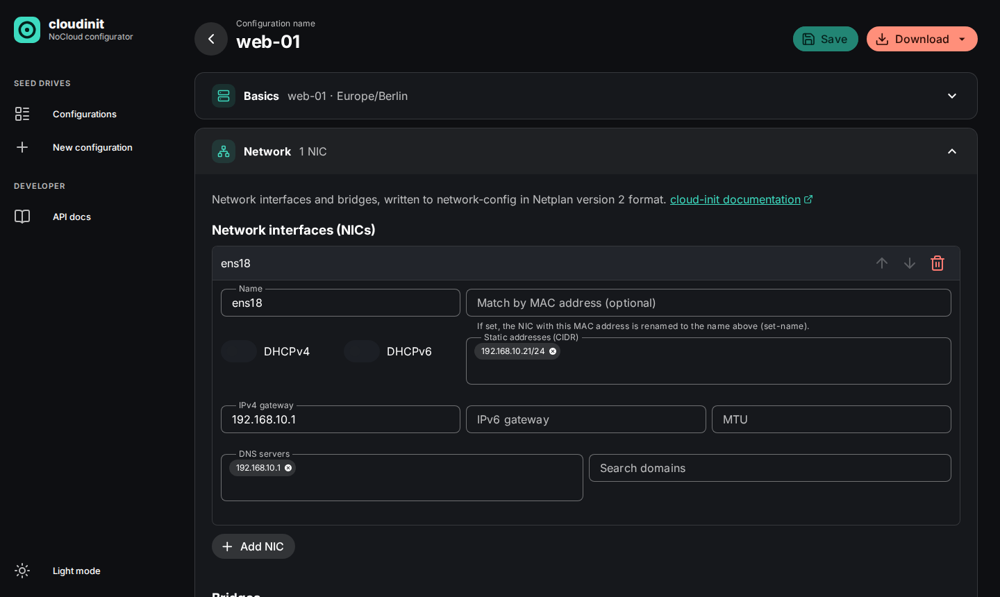
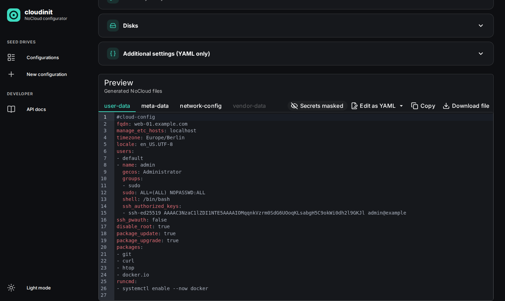

# cloudinit-nocloud-configurator

[](https://github.com/alirionx/cloudinit-nocloud-configurator/actions/workflows/docker-image.yml)
[](https://github.com/alirionx/cloudinit-nocloud-configurator/actions/workflows/helm.yml)
[](LICENSE)

A web app to build **cloud-init NoCloud seed drives** (ISO, RAW or QCOW2) from a guided form
with a live YAML preview. Fill in hostname, network, users, packages, files and disks, check the
generated `user-data`, `meta-data` and `network-config`, download the image and attach it to a VM.



## Why

cloud-init configures Linux VMs on their first boot. With the **NoCloud** datasource, the
configuration comes from a small drive labelled `cidata` that you attach to the VM. Writing that
configuration by hand is tedious and error-prone:

- many modules (`users`, `write_files`, `disk_setup`, `runcmd`, …), each with its own keys and
  pitfalls (password hashes, `defer` for files owned by new users, `bootcmd` running on every boot);
- separate files in different formats (cloud-config, Netplan v2);
- mistakes only show up when a VM boots, and unknown keys are often silently ignored;
- building the seed image needs tools like `xorriso`, `mtools` or `qemu-img`.

This app turns that into a form with validation at every field, shows the resulting YAML while
you type and builds the seed image for you. It targets **Debian** as the guest OS and anyone who
provisions VMs on Proxmox, KVM/libvirt, VMware or bare metal.

## Features

- **Guided form** for basics (hostname, FQDN, instance ID, timezone, locale), network (NICs by
  name or MAC, static/DHCP, bridges), packages, files (code editor, upload, permissions), boot
  commands (`bootcmd`/`runcmd` with drag & drop), users and groups (passwords hashed with
  SHA-512-crypt, SSH keys), SSH settings with secure defaults, and disks (partition, format, mount).
- **Live preview** of `user-data`, `meta-data`, `network-config` and `vendor-data`, with errors and
  warnings that link to the affected field, and masked password hashes.
- **Edit as YAML** with a round trip back into the form. Settings the form does not cover (e.g.
  `ntp`, bonds, VLANs) are kept as additional settings and never lost.
- **Validation** against the official cloud-init JSON schemas, with line numbers.
- **Seed images** as ISO 9660 (`cidata`), VFAT RAW or QCOW2, built per download without root
  privileges or loop mounts. Nothing is stored.
- **Configurations** are saved, listed, searched, duplicated and protected against concurrent
  overwrites.
- **REST API** for automation, documented with OpenAPI/Swagger at `/docs`.
- Light and dark theme, keyboard operable, WCAG 2.1 AA contrast.

## Quick start

### Standalone with Docker

```sh
docker run -d --name cloudinit -p 8000:8000 -v cloudinit-data:/app/data \
  ghcr.io/alirionx/cloudinit-nocloud-configurator:main
```

Open <http://localhost:8000>; the API documentation is at <http://localhost:8000/docs>.
Configurations are stored with TinyDB in the volume `cloudinit-data`.

### Stack with CouchDB (Docker Compose)

```sh
git clone https://github.com/alirionx/cloudinit-nocloud-configurator.git
cd cloudinit-nocloud-configurator
cp .env.example .env        # optional: set the CouchDB password and ports
docker compose up --build
```

The app runs on <http://localhost:8080> with CouchDB as datastore; CouchDB's web UI (Fauxton)
is available on <http://localhost:5984/_utils> from the local machine only.
`docker compose down -v` removes everything including the data.

### Kubernetes

Plain manifests (TinyDB on a PersistentVolumeClaim, one replica):

```sh
kubectl apply -f https://raw.githubusercontent.com/alirionx/cloudinit-nocloud-configurator/main/deploy/k8s/cloudinit-nocloud-configurator.yaml
kubectl -n cloudinit-nocloud-configurator port-forward svc/cloudinit-nocloud-configurator 8080:80
```

Helm chart from a [release](https://github.com/alirionx/cloudinit-nocloud-configurator/releases),
here with CouchDB installed alongside and two app replicas:

```sh
helm install cnc \
  https://github.com/alirionx/cloudinit-nocloud-configurator/releases/download/chart-v0.1.0/cloudinit-nocloud-configurator-0.1.0.tgz \
  -n cloudinit --create-namespace \
  --set couchdb.enabled=true --set replicaCount=2
```

The chart also supports an external CouchDB, Ingress (with annotations for an authenticating
proxy), resources and security contexts. See [deploy/README.md](deploy/README.md).

> [!IMPORTANT]
> The app has **no login**. Configurations can contain password hashes and SSH keys. Run it in a
> trusted network or behind an authenticating reverse proxy (e.g. Ingress with Basic Auth or
> OAuth2 Proxy).

## Using the app

1. **New configuration** → fill in the sections. Errors appear at the field once you leave it;
   warnings (e.g. "the VM will not be reachable via SSH") appear in the preview.
2. Check the files in the **preview**. Use **Edit as YAML** for anything the form does not offer.
3. **Save**, then **Download** the seed image as ISO, RAW or QCOW2.
4. Attach the image to the VM as an additional drive and boot a cloud image (e.g. Debian
   `genericcloud`):

   ```sh
   # QEMU/KVM
   qemu-system-x86_64 ... -drive file=web-01-cidata.iso,media=cdrom
   # libvirt
   virt-install ... --disk path=web-01-cidata.iso,device=cdrom
   # Proxmox (after uploading the ISO to the "local" storage)
   qm set <vmid> --ide2 local:iso/web-01-cidata.iso,media=cdrom
   ```

cloud-init only runs once per instance ID. To apply a changed configuration to an existing VM,
change the instance ID (Basics) or run `cloud-init clean` in the VM.

### Automation via the REST API

```sh
# Create a configuration
curl -s -X POST http://localhost:8000/api/configurations \
  -H 'Content-Type: application/json' \
  -d '{"name": "web-01", "basics": {"hostname": "web-01", "timezone": "UTC"},
       "packages": {"update": true, "packages": ["nginx"]}}'

# Download the seed image
curl -o web-01-cidata.iso "http://localhost:8000/api/configurations/<id>/image?format=iso"
```

All endpoints, models and validation rules are documented at `/docs` (Swagger UI) and
`/openapi.json`.



## Technology

| Area | Technology | Why |
|---|---|---|
| Backend | Python 3.13, [FastAPI](https://fastapi.tiangolo.com) | Typed REST API with OpenAPI docs for free; Python is the language of cloud-init itself |
| Model and validation | [Pydantic](https://docs.pydantic.dev) | One model is the single source of truth for form, API and YAML; field-level errors |
| YAML | PyYAML | Rendering and parsing happen only in the backend, so form, API and download always produce the same files |
| Schema checks | [jsonschema](https://python-jsonschema.readthedocs.io) with the official cloud-init schemas | Catches what cloud-init would reject or ignore |
| Seed images | `xorriso`, `mkfs.vfat` + `mtools`, `qemu-img` | Build ISO/VFAT/QCOW2 images without root or loop mounts, so the container runs unprivileged |
| Password hashing | `openssl passwd -6` | SHA-512-crypt without implementing cryptography; the plain text is never stored |
| Datastore | [TinyDB](https://tinydb.readthedocs.io) or [CouchDB](https://couchdb.apache.org) behind a repository interface | TinyDB needs nothing for single instances; CouchDB allows several replicas; the same contract tests run against both |
| Frontend | [Vue 3](https://vuejs.org), [Vite](https://vite.dev), TypeScript | Lightweight, fast builds; served as static files by FastAPI (one container) |
| UI | [Vuetify](https://vuetifyjs.com), [CodeMirror 6](https://codemirror.net), [Lucide](https://lucide.dev) icons, Inter font | Accessible components with light/dark themes; code editor with syntax highlighting; everything bundled, no CDN |
| Container | Multi-stage Docker build on `python:3.13-alpine` | Small image, non-root user, read-only root filesystem |
| Kubernetes | Helm chart, generated manifests | One chart for all variants; the plain manifests are rendered from it, so both stay in sync |
| Tests | pytest, Vitest, Playwright, axe-core, kind, QEMU | From unit tests to real browser tests and booting a Debian VM with the generated seed |

All dependencies are open source and actively maintained; see
[docs/dependencies.md](docs/dependencies.md) for the list with licenses.

## Development

### Prerequisites

- Python 3.13 and [uv](https://docs.astral.sh/uv/) (`uv` can install Python 3.13 for you)
- Node.js 24
- For seed images and password hashing:
  `sudo apt install xorriso mtools dosfstools qemu-utils openssl` (Debian/Ubuntu)
- Docker (optional): container build, CouchDB tests, Compose stack

### Run the components separately

**Backend** with auto-reload on <http://localhost:8000>:

```sh
cd backend
uv sync
uv run uvicorn app.main:create_app --factory --reload --port 8000
```

Configuration comes only from environment variables. By default TinyDB writes to
`backend/data/db.json`. To develop against CouchDB, start just the database from the
Compose file and point the backend to it:

```sh
docker compose up -d couchdb
DATASTORE_BACKEND=couchdb COUCHDB_URL=http://127.0.0.1:5984 COUCHDB_USER=admin COUCHDB_PASSWORD=change-me \
  uv run uvicorn app.main:create_app --factory --reload --port 8000
```

| Variable | Default | Description |
|---|---|---|
| `DATASTORE_BACKEND` | `tinydb` | `tinydb` or `couchdb` |
| `TINYDB_PATH` | `./data/db.json` | TinyDB file |
| `COUCHDB_URL`, `COUCHDB_USER`, `COUCHDB_PASSWORD` | – | Required for CouchDB |
| `COUCHDB_DATABASE` | `cloudinit` | Created if missing |
| `LOG_LEVEL` | `info` | `debug` … `critical` |
| `STATIC_DIR` | – | Serve the built frontend from this directory |
| `HOST`, `PORT` | `0.0.0.0`, `8000` | Used by `python -m app` |

**Frontend** with hot module replacement on <http://localhost:5173>; API, health and docs
requests are proxied to the backend on port 8000:

```sh
cd frontend
npm ci
npm run dev
```

**Everything in one process**, as in the container:

```sh
cd frontend && npm run build && cd ../backend
STATIC_DIR=../frontend/dist uv run python -m app
```

**Container image:**

```sh
docker build -t cloudinit-nocloud-configurator .
docker run --rm -p 8000:8000 cloudinit-nocloud-configurator
```

### Tests and checks

| What | Command |
|---|---|
| Backend tests (incl. CouchDB contract tests via Docker) | `cd backend && uv run pytest` |
| Backend lint and format | `cd backend && uv run ruff check . && uv run ruff format --check .` |
| Frontend type check and build | `cd frontend && npm run build` |
| Frontend unit tests | `cd frontend && npm test` |
| End-to-end tests in Chromium (incl. WCAG contrast) | `cd frontend && npx playwright install chromium && npm run test:e2e` |
| Container smoke test (non-root, read-only, TinyDB + CouchDB) | `scripts/smoke-test.sh` |
| Helm chart lint / manifests up to date | `helm lint deploy/helm/cloudinit-nocloud-configurator --strict` / `deploy/generate-manifests.sh --check` |
| Deployment test in a throwaway kind cluster | `scripts/kind-test.sh` |
| Boot a Debian VM with the generated seeds (QEMU/KVM) | `APP_URL=http://127.0.0.1:8000 scripts/boot-test.sh` |

### Repository layout

```
backend/        FastAPI app: model, rendering, parsing, image builder, repositories, tests
frontend/       Vue 3 app, unit tests (src/**/*.test.ts) and end-to-end tests (e2e/)
deploy/helm/    Helm chart
deploy/k8s/     Plain manifests, generated from the chart
docs/           Requirements specification, dependency list, screenshots
scripts/        Smoke, deployment (kind) and VM boot tests
compose.yaml    Local stack with CouchDB
```

## Contributing

Contributions are welcome. The project is driven by a requirements specification:

- [docs/requirements.md](docs/requirements.md) is the binding specification. Every requirement has
  a stable ID (`FR-…`, `NFR-…`, `DS-…`, `DEP-…`). New features or changed behavior are added
  there first, with a new ID and a change history entry.
- Reference the requirement IDs in commit messages and tests, e.g.
  `FR-007: tag input for packages`. Every acceptance criterion has at least one automated test.
- New dependencies must be open source with a license compatible with MIT, actively maintained
  and established (section 8.5), and are listed in [docs/dependencies.md](docs/dependencies.md).
- English everywhere: UI, API messages, logs, documentation and code comments.
- Chart changes: run `deploy/generate-manifests.sh` and commit the result; bump `version` in
  `Chart.yaml` to publish a new chart release.

Before opening a pull request, run the backend tests and lint, the frontend build and tests, and,
for UI changes, the end-to-end tests.

## License

[MIT](LICENSE)
